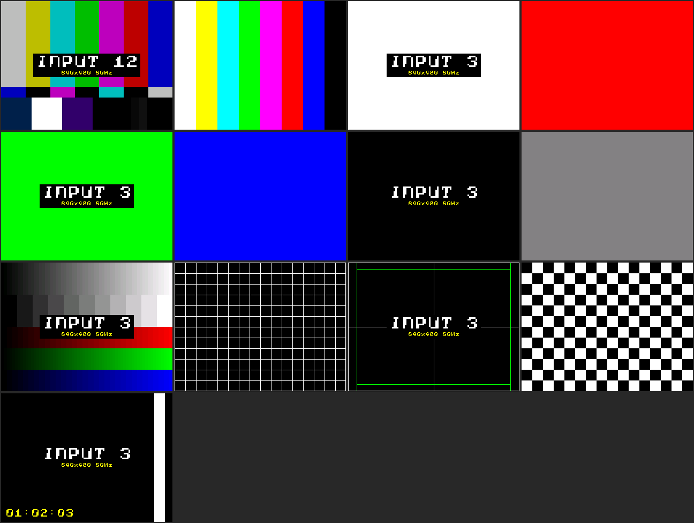

# Flipper AV Tools

Tools that turn a Flipper Zero into a pocket helper for AV systems programming and
commissioning. The main piece is a test pattern generator built on the Flipper Zero
Video Game Module.

| Component | What it does | Folder |
|---|---|---|
| Combined module firmware | Official Video Game Module firmware (screen mirroring) plus a test pattern generator | [`firmware/`](firmware/) |
| VGM Test Patterns app | Flipper app that selects patterns, resolution and a source label | [`apps/vgm_tpg/`](apps/vgm_tpg/) |
| Pixel Fixer app | Flipper app that runs a rapid colour-noise loop for stuck pixels and image retention | [`apps/pixel_fixer/`](apps/pixel_fixer/) |
| EDID Reader app | Flipper app that reads and decodes a display's EDID through an HDMI breakout board | [`apps/edid_reader/`](apps/edid_reader/) |
| IR converter | Browser page that converts Flipper `.ir` files to Pronto hex and Global Caché `sendir` | [`ir-converter/`](ir-converter/) |
| BadUSB scripts | USB HID path test and keep-awake scripts | [`badusb/`](badusb/) |

## Quick install

Prebuilt files are in [`bin/`](bin/).

1. **Module firmware:** detach the Video Game Module, hold its BOOT button and plug its
   USB-C port into a computer. Copy `bin/vgm-combined-v4.uf2` to the drive that appears.
2. **Flipper apps:** with qFlipper, copy the `.fap` files in `bin/` to
   `SD Card/apps/GPIO/`.
3. Attach the module and connect HDMI. It mirrors the Flipper's screen as usual; opening
   either app switches the output to patterns, and closing it returns to mirroring.

The apps are built for Flipper firmware 1.5.1 (API 88.2). Rebuild them with
[ufbt](https://github.com/flipperdevices/flipperzero-ufbt) for other versions.

## What has been tested

| Item | Status |
|---|---|
| Screen mirroring and test patterns at 640x480 (firmware v3) | Working on real hardware |
| VGM Test Patterns app | Working on real hardware |
| Firmware v4 noise pattern and the Pixel Fixer app | Tested on a host build only, not yet on hardware |
| 720x480 and 1280x720 30 Hz modes | Not confirmed on hardware; 720p overclocks the module and uses a non-standard timing |
| EDID Reader app | Decoder checked against `edid-decode` on 398 real EDIDs; pin driver not yet run on hardware |
| IR converter | Unit tests pass against known LG, Samsung and Sony codes; not yet fired at a real device |
| BadUSB scripts | Written from the firmware's script documentation; not yet run |

## Limits of the pattern generator

- The module generates video in software, so 1080p and 4K are out of reach. It proves
  that a path passes video and that routing and scaling work. It does not test bandwidth,
  HDR or HDCP.
- Patterns are drawn at half resolution and pixel-doubled, so the finest line is two
  display pixels wide.
- The output is DVI-style video with no audio.

## Licence

Copyright (C) 2026 Yara162. Released under the [GNU General Public License v3.0](LICENSE):
you may use, change and redistribute this work, provided you keep the copyright and
licence notices (that is, give credit) and release your changes under the same licence.

## Credits

- The combined firmware is a patch on top of
  [flipperdevices/video-game-module](https://github.com/flipperdevices/video-game-module),
  which is fetched at build time. That repository had no licence file at the pinned commit.
- Video output uses [PicoDVI](https://github.com/Wren6991/PicoDVI) (BSD-3-Clause); the
  on-screen font comes from its assets.
- IR protocol timings follow the
  [Flipper Zero firmware](https://github.com/flipperdevices/flipperzero-firmware) source.
