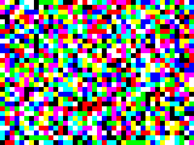

# Pixel Fixer

Flipper Zero app that runs a full-screen loop of rapidly changing colour blocks through
the [combined module firmware](../../firmware/). This kind of loop is used to free stuck
pixels and clear temporary image retention.

> **Seizure warning:** the pattern is rapid full-screen flashing in saturated colours and
> can trigger seizures in people with photosensitive epilepsy. Do not watch the display
> while it runs, and do not run it where others can see it unwarned.

The app opens on a warning screen and sends nothing to the module until OK is held.
Because the module is still mirroring at that point, the warning also appears on the
connected display.



## Controls

| Button | Action |
|---|---|
| Hold OK (warning screen) | Start |
| Left / Right | Chunk size: 4, 8, 16, 32, 64 or 128 display pixels |
| Up / Down | Speed: 60 changes per second down to 2 (half that in the 30 Hz mode) |
| OK | Pause (black screen) or resume |
| Hold OK | Next resolution |
| Back | Exit; the module returns to mirroring after about 2 seconds |

## What to expect

- Each block is one of eight full-intensity colours (black, red, green, blue, yellow,
  cyan, magenta, white), chosen at random for every new image.
- 640x480 is a 4:3 picture. On a widescreen display set to keep the aspect ratio, the
  side strips are not exercised; set the display to stretch or fill.
- It helps with stuck pixels and temporary retention. True OLED burn-in is uneven pixel
  wear and no pattern reverses it; long runs of bright content add a little more wear.

## Build and install

```bash
ufbt
```

Copy `dist/pixel_fixer.fap` to `SD Card/apps/GPIO/`.
